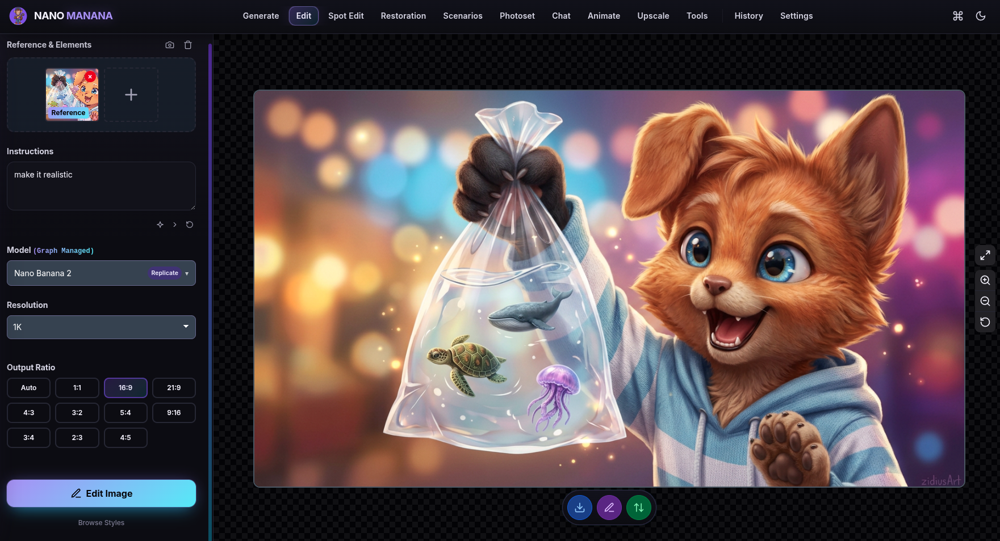

  

  <strong>A desktop workstation for AI images and video.</strong> 
  Google Gemini and Replicate, one node graph, your own API keys.

  
  

> **Alpha.** This is an early build. Every release works end to end, but sections still move between versions and behaviour gets settled as they do. Keep your own copies of anything you care about.
>
> **Windows signing.** The installer and the portable exe are not code signed yet, so SmartScreen warns once: press **More info**, then **Run anyway**. Code signing is planned.

Nano Manana is a desktop creative desk. Generate, edit, restore, animate, and upscale without hopping between vendor sites. You bring the keys. The app keeps the workflow, the history, and the routing.

This repository ships **built Electron apps only**. Source is not published here.

## Download

Latest release: **[v0.3.28](https://github.com/stark1ng/nano-manana/releases/tag/v0.3.28)**

| Platform | File | Use it when |
| --- | --- | --- |
| Windows | [Nano.Manana.Setup.0.3.28.exe](https://github.com/stark1ng/nano-manana/releases/download/v0.3.28/Nano.Manana.Setup.0.3.28.exe) | You want a normal install |
| Windows | [Nano.Manana.0.3.28.exe](https://github.com/stark1ng/nano-manana/releases/download/v0.3.28/Nano.Manana.0.3.28.exe) | You want a portable build |
| Linux | [Nano.Manana-0.3.28.AppImage](https://github.com/stark1ng/nano-manana/releases/download/v0.3.28/Nano.Manana-0.3.28.AppImage) | Any distro. `chmod +x` and run |
| Linux | [nano-manana_0.3.28_amd64.deb](https://github.com/stark1ng/nano-manana/releases/download/v0.3.28/nano-manana_0.3.28_amd64.deb) | Debian, Ubuntu, Mint |

Since **0.3.13** the app updates itself: **Settings → Updates** compares the build with this page, downloads the new file, and restarts into it. The Windows installer and the Linux AppImage can do that in place. The portable EXE and the DEB cannot replace themselves, so for those the panel opens this page.

## The desk

  

**Generate.** Prompt, aspect ratio, model. The result stays on a checkerboard canvas with download, edit, and send-on actions.

  

**Edit.** Drop a reference, write the change, pick the output ratio.

  

**Spot Edit.** Paint the region. The rest of the picture stays put.

The same shell also holds Restoration, Scenarios, Photoset, Chat, Animate, Upscale, Tools, and History.

## Themes

**Settings → Appearance** carries five skins, each with a light and a dark variant:

| Skin | Character |
| --- | --- |
| **Classic** | The original grey-blue desk |
| **Modern** | Neutral zinc, flat surfaces, no colour cast |
| **Obsidian** | Violet-black, deep contrast — the skin a fresh install starts on |
| **Lando** | Warm olive and cream, lime accents |
| **Motion** | Indigo-black with violet accents, spring transitions, staggered entrances and hover lift |

A skin is not just a palette swap: every section, panel, picker, portal menu, modal and the **Node API graph** follow it. As of 0.3.25 the graph has its own light palette per skin — a mid-tone canvas with lighter panels and near-white nodes, instead of a dark canvas behind a light window.

## What 0.3.28 changes

This release is **Simple mode**. The node graph is still the only engine — Simple assembles a graph for you from the API Pocket keys and shows it as provider cards with model toggles instead of a canvas.

- **A card is a Pocket key.** Paste a key and every section is wired in one step; two keys for one provider become failover.
- **The Pocket is the only wallet.** The old per-category list is read once on first launch and copied across.
- **Simple is a template.** Its graph is read-only on the canvas; **Duplicate & edit** forks it into «Simple (my)» and the original stays pristine.
- **Mode and profile are independent.** Picking a profile in the list changes what routes, not what you see; the canvas comes back only on **Graph** or **Activate**, and the state is spelled out (`● Active · Simple`, `● Active`, `Activate`).
- **Per-profile section defaults**, so a model picked in Advanced no longer changes what Simple runs.
- **Magic Prompt and the client-side upscaler** are part of every Simple graph.
- **Model panel**: a `15 / 109` counter, **All / None** that honour the search, and role chips showing the sections each model can serve. The seed is up to 15 models per provider — cheapest per section first, upscale and video capped at two each.

Fixed while testing it: the canvas could write the Advanced node set into the Simple profile on unmount; Graph with no user profile sat on the Simple graph; the Active badge depended on the view flag; creating a profile left you in Simple.

## What 0.3.25 changed

This release is the theme pass. Every skin was measured in both modes across all 12 sections — text colour against its real background, not eyeballed.

- **Classic, light mode.** Console panels (Activity Log, Budget, Updates) were painted with dark-only tokens: buttons measured 1.1–1.3:1, effectively invisible. They now have a light token set of their own, and muted text, hotkey chips, placeholders and the red Reset button clear 4.5:1.
- **Modern.** The skin is zinc, but shared chrome and Tailwind's slate greys painted it blue. The grey scale is re-pointed to zinc inside the skin, so drop zones, panels, pickers and selects sit in one family.
- **Obsidian.** Base grey classes were mapped to the violet-black scale, but the semi-transparent variants and several hand-written slate values were not — pickers, queue cards, toasts and dropdown panels stayed blue against a violet canvas. All mapped now, plus violet console tokens in both modes.
- **Lando.** Its colour block remapped grey text without scoping it to dark mode, so dark surfaces got dark text: the zoom **Default** button measured 1.28:1 and the **Updates** title 1.15:1. Fixed in dark, and the light theme got its muted, red and accent lifts.
- **Motion.** Dark mode was already uniform; light mode had washed-out hints, scale ticks, hotkey digits, and a lime caption at 1.92:1 on cream. Fixed.
- **Node API graph, light mode.** Portaled menus — model and Model+ pickers, the node gear panel, API Pocket keys, grid options, Share / Backup, the align toolbar and the **Edit pool** / **Section** modals — are rendered outside the graph container, so they kept dark slate chrome (“open a menu and everything goes black”). They follow the skin now. Light-accent labels inside node bodies were invisible on white and are darkened inside the graph.
- **Grid tool.** The caption no longer carries a black letter outline in light mode, the frame is a 1px soft border instead of a 2px accent ring, and its options menu takes its colours from variables instead of hardcoded white-on-black.
- **Transfer menu** (“To Generate / To Edit / …”) stopped being Tailwind slate in every dark theme: Motion and Modern get their own chrome, Classic keeps slate by design.

From 0.3.13, still in place:

- **Settings → Updates** shows the build you are running, the newest release here, and one button to get it — progress is real bytes, the file is checked, then the app replaces itself and comes back.
- **A dot next to the Settings tab** when a newer release is out.
- **Main** is the default Node API profile: Google and Replicate wired, every catalog model connected to its section.
- **Magic Prompt** in that profile: Gemini 2.5 Flash in, out to Generate, Edit, Photoset, Scenarios, Animate and Upscale.

## Connect an API

You need a network connection and at least one key.

1. On first launch, pick a folder if you want settings and history on disk. You can skip it and stay in the app.
2. Open **Node API** — the mode is **Simple**.
3. Paste a key from [Google AI Studio](https://aistudio.google.com/) into the **API Pocket** on the right. A provider card appears with its models already connected to every section; add a [Replicate](https://replicate.com/account/api-tokens) token the same way.
4. Click a card to switch models on and off. The list is cheapest-first, and the chips on each model are the sections it can serve.

Simple mode is the same node graph, assembled from your Pocket keys — not a separate engine. **Graph** opens the full canvas (several keys, failover order, Schema URL, custom models). The Simple graph is a template there: edit it with **Duplicate & edit**, and the original stays as the default.

**API Pocket** is the only place keys live; the old per-category key list is read once, on first launch, and copied into it.

Google covers image, chat, and video. Replicate covers Nano Banana, Flux-class generate, video, and the upscale list. Local ships the client-side upscaler with no key at all.

## Requirements

- Windows 10/11 x64, or a current 64-bit Linux desktop
- Internet access while you generate
- A Google AI Studio key
- A Replicate token if you want those models

macOS is not published yet: a macOS build has to be produced and signed on macOS, it cannot be cross-built from Linux.

## License

Nano Manana is freeware for personal and commercial use. The source is not part of this repository. Redistribution of modified builds is not permitted. See the app license on first launch.
